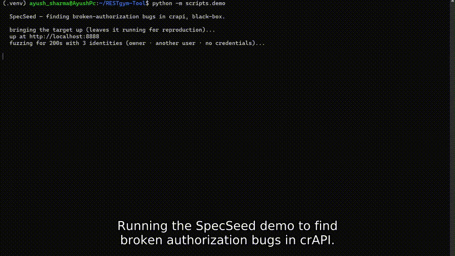

# SpecSeed

**Find broken-authorization bugs (BOLA / BFLA — the #1 API vulnerability) in your REST API before you ship.**
Black-box, deterministic, no AI required — and it stays silent on correct code.



SpecSeed drives every synthesized request sequence with **three identities at once** — the resource owner, a second legitimate user, and an unauthenticated client — and compares what each is allowed to see. That cross-identity comparison is what turns three clean `200`s into a finding. Give it an OpenAPI spec and a running instance; it needs no source code, no database access, and no remote LLM.

> Why not a normal fuzzer? A single-client fuzzer that gets `200 OK` from `GET /orders/42` has no way to know that the token belongs to user B and the order belongs to user A. SpecSeed does, because it asks the other identities too.

---

## What makes it different

- **Authorization-first.** Purpose-built for BOLA, BFLA, and broken/missing authentication — OWASP API Security's #1 and #5 — not just crashes and schema checks.
- **Sound by design.** Every finding is re-run, replayed on a clean instance, and split into *violations* vs *warnings*. On a real, correct API (Genome Nexus) it reports **zero false violations**. It doesn't cry wolf.
- **Deterministic and private.** Seeded search, reproducible runs, no data leaves your network, no per-scan token bill. The optional LLM assist is **off by default** and, when on, is cache-replayable offline.
- **Every finding ships a `curl`.** Reproduce any result against a fresh instance with the exact command SpecSeed records.

---

## Quickstart (see it find a real bug)

SpecSeed ships with OWASP **crAPI** wired up — a deliberately-vulnerable API that is safe and legal to test. In a few minutes you'll watch it find a real BOLA.

```bash
# 1. deps (Python 3.10+; a virtualenv is recommended)
pip install -r requirements.txt            # httpx, PyYAML

# 2. get the crAPI compose file (one time)
mkdir -p ~/crapi && curl -fsSL \
  https://raw.githubusercontent.com/OWASP/crapi/develop/deploy/docker/docker-compose.yml \
  -o ~/crapi/docker-compose.yml

# 3. bring crAPI up and hunt it (one command — it starts the stack, runs, verifies)
python -m eval.campaign --apis crapi --budget 300 --rounds 1 --no-engine --out runs/

# 4. read the report
cat runs/REPORT.md
```

You'll see confirmed violations like:

```text
## Confirmed violations (5)

### 1. a second user read back the exact data the first user saw from a protected resource
- oracle: cross_user_access
- operation: GET /identity/api/v2/vehicle/{vehicleId}/location

Reproduce from a clean instance:
curl -s "$BASE/identity/api/v2/vehicle/<id>/location" -H "Authorization: Bearer $TOKEN_B"
# -> 200 with another user's GPS location + owner email
```

> A clean, config-driven CLI (`specseed scan --config target.yaml`) and a GitHub Action are on the [roadmap](#roadmap). Today the campaign runner is the entry point.

### Point it at your own API

Add an entry to `eval/apis.py` (spec path, base URL, two test identities, scope), or follow an existing entry such as `vampi` / `crapi` as a template. Then:

```bash
python -m eval.campaign --apis my-api --hours 1 --no-engine --out runs/
```

---

## How it works

```
spec + running API
      │
      ▼
scheduler → synthesizer → mutator → executor → oracles → reward ↺
              (knowledge graph · state machine feed back)
      │
      ▼
reproduce → verify on clean instance → split violations / warnings
```

- **Relational Knowledge Graph** tracks who-owns-whom, so nested calls get ids that are actually related (the pet that belongs to *this* owner), not a wrong-but-type-correct id that 404s.
- **17 oracles**, each an isolated class: authorization (`cross_user_access`, `broken_function_auth`, `missing_auth`, `cross_entity_access`, `mass_assignment`), contract/CRUD (`schema_conformance`, `crud_roundtrip`, `zombie_resource`), lifecycle/concurrency (`safety`, `idempotency`, `repeated_delete`, `race_condition`, `dangling_reference`), and injection/response (`second_order_injection`, `reflected_payload`, `timing_injection`, `cors_misconfig`).
- **Soundness pipeline**: reproduction re-check → replay verification → severity split, plus normalization tolerance and per-API scoping for public-by-design endpoints.
- **Optional LLM planner** (`LLM_PLANNER=1`): proposes *values* to reach deeper states; it never judges a response, so a wrong hint can't create a false finding. Cached for offline-reproducible runs.

Full design and evaluation: [`docs/paper.md`](docs/paper.md) · architecture notes in [`docs/architecture/`](docs/architecture/).

---

## Results

| Target | What it is | Result |
|---|---|---|
| OWASP crAPI (44 ops) | deliberately vulnerable | 5 confirmed authz/auth violations (BOLA ×2, BFLA, broken-auth ×2) |
| OWASP VAmPI (14 ops) | deliberately vulnerable | 6 OWASP-Top-10 findings |
| Genome Nexus (23 ops) | **real, correct** production API | **0 false violations** (soundness test) |

A one-hour unattended run on crAPI issued 162k requests at a peak of 159 MB with zero tool errors.

---

## How it compares

| Tool | Approach | Authz bugs | Soundness focus | LLM role |
|---|---|---|---|---|
| RESTler | stateful grammar fuzzing | crash/5XX | — | none |
| EvoMaster | evolutionary, white+black box | coverage | — | none |
| Schemathesis | property-based from OpenAPI | schema | — | none |
| **SpecSeed** | **stateful + 3-identity differential** | **BOLA/BFLA** | **reproduce + verify + split** | **reach only** |

SpecSeed is an authorization-and-semantics pre-check, not a full pentest. It won't find deep business-logic, client-side, or infrastructure defects.

---

## Roadmap

- `specseed scan --config target.yaml` — config-driven targets and a proper CLI.
- A **GitHub Action** that fails a build on *new* authorization violations (baseline + diff) — a CI security gate.
- In-protocol spec discovery for APIs that don't ship an OpenAPI document.

---

## Contributing

Issues and PRs welcome. New bug classes are added as isolated oracle classes in `restleague/oracles/` — one class, one `check(sequence, context)` method — so a new detector can't destabilize the others. Run the suite with:

```bash
for t in tests/check_*.py; do python -m "tests.${t##*/check_}" ; done   # or: python -m tests.check_oracles
```

---

## Running in the RESTgym competition harness

SpecSeed began as an entry for REST League 2027 and still runs under RESTgym. Place the directory at `restgym/tools/specseed/`, then from the RESTgym root:

```bash
docker build -f tools/specseed/Dockerfile -t restgym-specseed .
./restgym.sh b && ./restgym.sh l && ./restgym.sh v && ./restgym.sh a
```

RESTgym provides `HOST`, `PORT`, `API`, and `TIME_BUDGET`; the spec is mounted at `/specifications/$API-openapi.json`. Optional auth is configured via `AUTH_LOGIN_PATH`, `AUTH_LOGIN_BODY`, `AUTH_TOKEN_FIELD`, `AUTH_TOKEN_HEADER`, `AUTH_TOKEN_PREFIX`. The frozen competition engine (`restleague/engine`, `restleague/spec`) is unchanged; all authorization work is additive ("Track A").

---

## License

Apache License 2.0 — see [`LICENSE`](LICENSE).

## Authors

Ayush Sharma, Sayan Mandal, and Biraj Sarkar — Indian Institute of Technology Guwahati.
