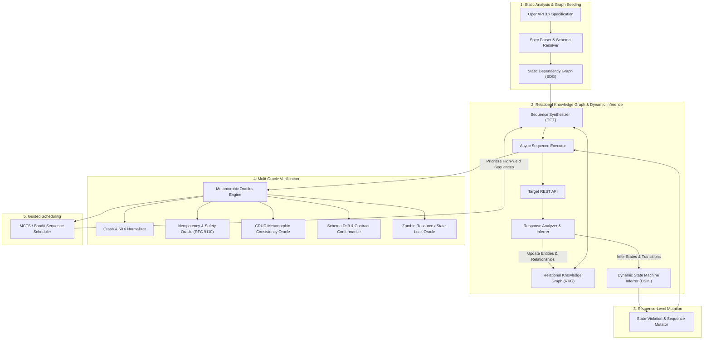
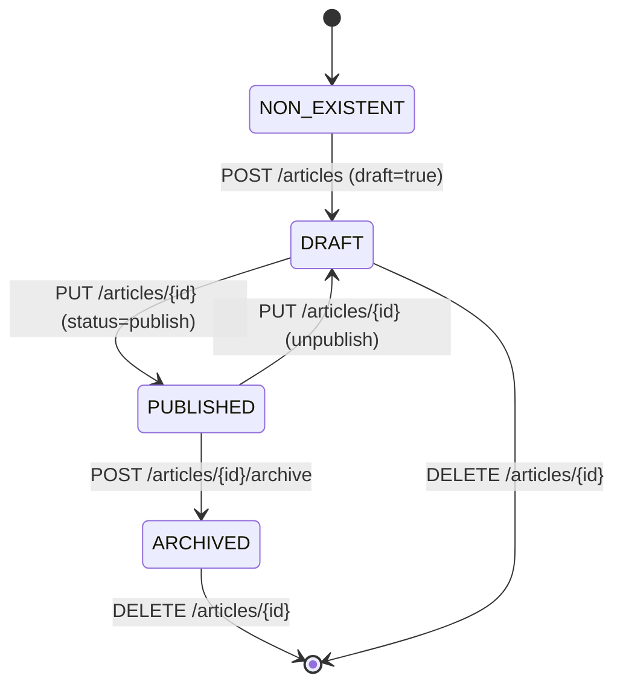
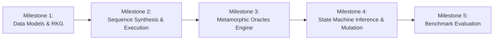
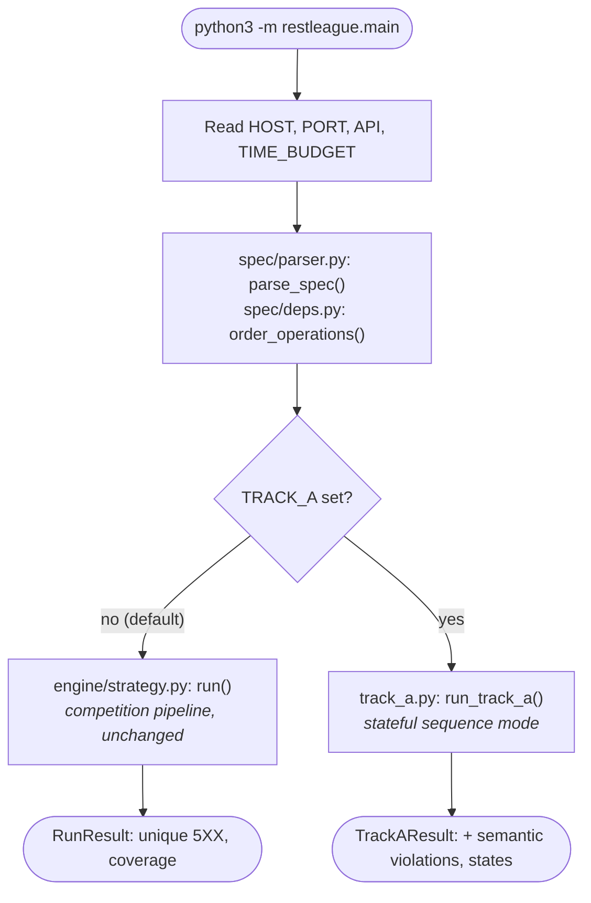
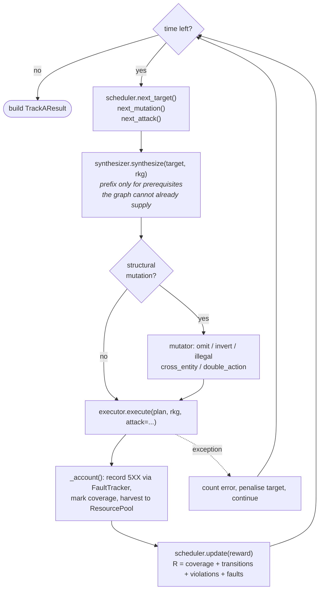
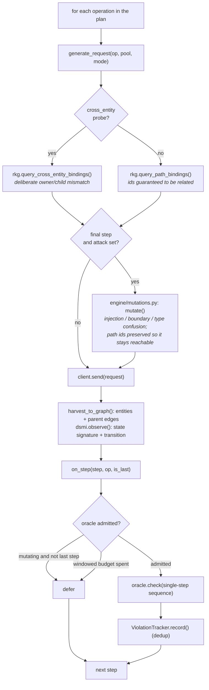
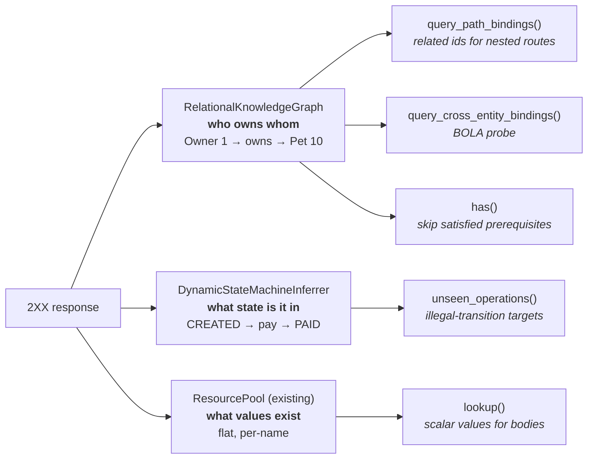
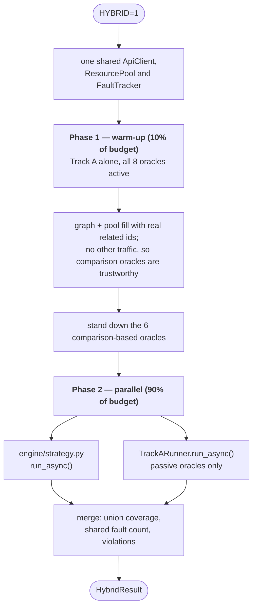

# SpecSeed Track A: Stateful Sequence Fuzzing, Dynamic State Machine Inference & Metamorphic Verification

## 1. Executive Summary & Academic Objectives

**SpecSeed** originated as a black-box REST API testing tool for the REST League 2027 competition under a 60-minute hard time budget and crash-only (`5XX`) fault detection. The current engine ([`engine/strategy.py`](file:///home/ayush_sharma/RESTgym-Tool/restleague/engine/strategy.py)) already runs several concurrent async workers and already sequences dependent calls implicitly — [`spec/deps.py`](file:///home/ayush_sharma/RESTgym-Tool/restleague/spec/deps.py) orders creators before consumers, so e.g. `POST /owners` runs before `POST /owners/{ownerId}/pets`. What it does *not* have is: an explicit relational model of which child belongs to which parent (ids are matched by name/type only, in a flat pool — see §4.1), sequence-level mutation (reordering/omitting/duplicating whole request chains), a notion of entity lifecycle state, or any oracle beyond "did the server return 5XX".

As an advanced academic term project, this design transitions SpecSeed into an end-to-end **stateful, property-driven REST verification system** that adds those four things. The core objective is discovering complex logic flaws, race conditions, relational state corruptions, and contract drifts that cannot be revealed by isolated, single-operation fuzzing.

> [!NOTE]
> Unlike classical black-box fuzzers (*e.g.*, Schemathesis) that generate single requests independently, **Track A** treats API testing as navigating a dynamic, multi-entity state graph where requests are executed in context-aware sequences.

> [!IMPORTANT]
> Track A is an **additive, feature-flagged extension**, not a rewrite of the competition entry point. `restleague/main.py` → `engine/strategy.py` keeps running the pipeline already validated against RESTgym (see `SUBMISSION.md`) unless Track A is explicitly enabled. New subsystems live in new packages (`state/`, `sequence/`, `oracles/`); `engine/strategy.py` and `engine/faults.py` are extended, not replaced, so the existing submission path is never put at risk by this work.

---

## 2. Selected Benchmark Suite

To evaluate stateful testing rigorously, the benchmark APIs must exhibit multi-tier entity lifecycles, foreign-key relational hierarchies, and distinct lifecycle states (*e.g.*, `DRAFT` $\to$ `PENDING` $\to$ `ACTIVE` $\to$ `COMPLETED`).

Operation counts below are measured directly from the specs already bundled in [`specs/`](file:///home/ayush_sharma/RESTgym-Tool/specs/) (`grep`-counted per-method paths), not estimated.

| Benchmark API | Domain | Operations | State & Relational Characteristics | Academic Relevance |
| :--- | :--- | :--- | :--- | :--- |
| **Spring PetClinic** | Clinic Management | 35 | `Owner` $\to$ `Pet` $\to$ `Visit`. Cascade deletions, path-based hierarchical routing. | Standard baseline in REST testing literature (*RESTler*, *EvoMaster*). Bundled in [`pet-clinic-openapi.json`](file:///home/ayush_sharma/RESTgym-Tool/specs/pet-clinic-openapi.json). |
| **Features-Service** | Feature Flags / Config | 18 | `Product` $\to$ `Feature` $\to$ `Toggle State` (Enabled / Inverted / Disabled). | Validates flag toggling and state flipping logic. Bundled in [`features-service-openapi.json`](file:///home/ayush_sharma/RESTgym-Tool/specs/features-service-openapi.json). |
| **Market / E-Commerce** | Order Processing | 13 | `Customer` $\to$ `Cart` $\to$ `Order`, with separate `pay` and `delivery` endpoints implying an order lifecycle (the spec has no explicit `status` enum — the lifecycle is implicit in which endpoints are reachable from which state). | Benchmark for illegal state transitions and double-action race conditions (e.g. paying twice). Bundled in [`market-openapi.json`](file:///home/ayush_sharma/RESTgym-Tool/specs/market-openapi.json). |
| **Project Tracking System** | Issue / Project Management | 59 | Deep resource hierarchy (projects → tasks/tickets, with explicit `status` fields) and the largest operation count of any bundled spec. | Demonstrates scalability on a large schema with real lifecycle-state fields and complex cross-entity dependencies. Bundled in [`project-tracking-system-openapi.json`](file:///home/ayush_sharma/RESTgym-Tool/specs/project-tracking-system-openapi.json). |

> [!NOTE]
> The original draft of this table also listed **Conduit (RealWorld Backend)** and **Scout-API / OCV** as benchmarks. Neither spec exists in this repository (`specs/` has no `conduit`, `scout`, or `ocv` file) — they were aspirational and have been dropped here. If multi-user auth-boundary testing (Conduit's stated purpose) becomes a priority, that spec needs to be sourced and added to `specs/` before it can be used; until then, evaluation targets only the four rows above, all already present in this repo.

---

## 3. System Architecture

The evolved system operates through five cooperating subsystems:



---

## 4. Core Subsystem Specifications

### 4.1. Relational Knowledge Graph (RKG)
*Replaces the flat, single-map storage in [`pool.py`](file:///home/ayush_sharma/RESTgym-Tool/restleague/engine/pool.py).*

#### Problem
In the original design, scalar IDs were stored in disconnected deques. If the pool contained Owner 1, Owner 2, Pet 10 (owned by 1), and Pet 20 (owned by 2), generating `/owners/{ownerId}/pets/{petId}` could pair Owner 1 with Pet 20, yielding uninformative `404 Not Found` responses that wasted budget.

#### Graph Schema
- **Entity Nodes ($V_E$):**
  $$v = \langle \text{entity\_type}, \text{id}, \text{state}, \text{attributes}, \text{created\_by\_op}, \text{timestamp} \rangle$$
- **Relational Edges ($E_R$):**
  $$e = \langle v_{\text{parent}}, v_{\text{child}}, \text{relation\_type} \rangle \quad \text{e.g., } \text{Owner}(1) \xrightarrow{\text{owns}} \text{Pet}(10)$$

#### Relational Query API
```python
class RelationalKnowledgeGraph:
    def add_entity(self, entity_type: str, entity_id: Any, attributes: dict, parent: tuple | None = None) -> None:
        """Register a newly harvested entity and link to its parent node."""
        ...

    def query_path_bindings(self, path_template: str, op: Operation) -> dict[str, Any] | None:
        """
        Traverse edges to resolve multi-parameter paths.
        E.g., for /owners/{ownerId}/pets/{petId}/visits, returns an active tuple (owner_1, pet_10)
        guaranteeing pet_10 belongs to owner_1.
        """
        ...

    def cascade_delete(self, entity_type: str, entity_id: Any) -> None:
        """Mark entity and all child nodes as DELETED/STALE for stale-reference testing."""
        ...
```

---

### 4.2. Sequence Synthesizer & Dynamic Generation Trees (DGT)

Instead of executing single HTTP requests, the generator produces executable test sequences $\sigma$:
$$\sigma = \langle R_1, R_2, \dots, R_k \rangle, \quad 2 \le k \le 8$$

#### Generation Mechanics
1. **Target Selection:** The scheduler selects a target operation $O_{\text{target}}$ (*e.g.*, `POST /owners/{ownerId}/pets/{petId}/visits`).
2. **Prefix Resolution:** Inspect the Static Dependency Graph ([`deps.py`](file:///home/ayush_sharma/RESTgym-Tool/restleague/spec/deps.py)) for unsatisfied dependencies:
   - Needs `petId` $\implies$ requires `POST /owners/{ownerId}/pets`
   - Needs `ownerId` $\implies$ requires `POST /owners`
3. **Sequence Construction:** Assemble setup sequence:
   $$R_1(\text{POST /owners}) \longrightarrow R_2(\text{POST /owners/\{ownerId\}/pets}) \longrightarrow R_3(\text{Target})$$
4. **Context Passing:** The output of $R_1$ binds into the path parameters of $R_2$ and $R_3$ dynamically at runtime.

---

### 4.3. Dynamic State Machine Inferrer (DSMI)

The DSMI reconstructs the black-box entity state model by monitoring runtime feedback:



#### State Fingerprinting
For each observed entity, compute its state signature $S(e)$ using:
1. **Explicit Attributes:** Values of fields matching regex `^(status|state|phase|stage|flag)$` (*e.g.*, `"PAID"`, `"PENDING"`).
2. **Capability Mask:** The set of HTTP methods currently accepted by the entity:
   $$\text{Cap}(e) = \{ M \in \{\text{GET, PUT, PATCH, DELETE}\} \mid \text{HTTP status} < 400 \}$$
3. **Inferred Transition:**
   $$\delta: S_{\text{prev}} \times \text{Operation}(P) \xrightarrow{\text{Status Code}} S_{\text{next}}$$

---

### 4.4. Sequence Mutator & State-Violation Fuzzer

Extends the single-payload mutations in [`mutations.py`](file:///home/ayush_sharma/RESTgym-Tool/restleague/engine/mutations.py) to sequence-level structural modifications:

| Mutation Operator | Action on Sequence $\sigma = \langle R_1, \dots, R_k \rangle$ | Target Vulnerability |
| :--- | :--- | :--- |
| **Illegal State Transition** | Injects an operation invalid for the entity's current state (*e.g.*, `POST /checkout` on an `ARCHIVED` cart). | Unchecked state machine transitions, business logic bypass. |
| **Prerequisite Omission** | Removes setup steps (*e.g.*, calls `POST /pay` directly without calling `POST /orders`). | Missing precondition validation, null pointer exceptions. |
| **Sequence Inversion** | Swaps two operations (*e.g.*, `PUT /update` executed prior to `POST /create`). | Handling of out-of-order calls, race-like conditions. |
| **Cross-Entity Injection** | Swaps child entity IDs across different parents (*e.g.*, Owner A's pet passed under Owner B's path). | Broken Object Level Authorization (BOLA), isolation failure. |
| **Atomic Double Action** | Duplicates the critical transaction request concurrently (*e.g.*, concurrent duplicate checkout calls). | Race conditions, double-spending, non-atomic increments. |

---

### 4.5. Metamorphic & Semantic Oracles Engine

Extends the crash-only (`5XX`) tracking in [`faults.py`](file:///home/ayush_sharma/RESTgym-Tool/restleague/engine/faults.py) with formal metamorphic testing rules:

```
                            ┌───────────────────────────────────────┐
                            │      Metamorphic Oracle Pipeline      │
                            └───────────────────┬───────────────────┘
                                                │
         ┌───────────────────────┬──────────────┴───────────────┬───────────────────────┐
         ▼                       ▼                              ▼                       ▼
┌──────────────────┐    ┌──────────────────┐          ┌──────────────────┐    ┌──────────────────┐
│ RFC 9110 Safety  │    │ CRUD Consistency │          │ Schema Contract  │    │ Zombie Resource  │
│  & Idempotency   │    │    Roundtrip     │          │   Conformance    │    │    Detection     │
└────────┬─────────┘    └────────┬─────────┘          └────────┬─────────┘    └────────┬─────────┘
         │                       │                             │                       │
         ├─ GET alters state?    ├─ POST body fields           ├─ Response payload     └─ 204 DELETE
         ├─ PUT twice produces   │  persist into GET?          │  violates OpenAPI        followed by 200
         │  different response?  └─ PATCH wipes                │  declared schema?        GET (State Leak)
         └─ DELETE twice !=         unrelated fields?          └─ Leaked internal
            404/204?                                              stack traces?
```

1. **RFC 9110 Idempotency & Safety Oracle:**
   - Sequential `GET` requests must not change server state representation.
   - Sequential identical `PUT` calls must yield identical states:
     $$\text{State}(\text{PUT}(R)) \equiv \text{State}(\text{PUT}(R) \circ \text{PUT}(R))$$
   - Repeated `DELETE` must return `404` or `204`, never trigger a `500` server crash.
2. **CRUD Consistency Oracle:**
   - Given creation request $R_{\text{POST}}$ with attributes $\mathcal{A}$, the immediate $R_{\text{GET}}$ on the created entity must satisfy:
     $$\forall (k, v) \in \mathcal{A}_{\text{writable}}, \quad \text{Response}_{\text{GET}}[k] == v$$
3. **Zombie Resource Oracle:**
   - If `DELETE /entities/{id}` returns `204 No Content` or `200 OK`, a subsequent `GET /entities/{id}` must return `404 Not Found`. Returning `200` flags a silent deletion failure or database leak.
4. **Contract Conformance Oracle:**
   - Validates response schemas against OpenAPI specifications using JSON Schema validators. Flags unhandled application exceptions returned disguised under `200 OK` or `400 Bad Request`.

> [!WARNING]
> **False-positive risk — these oracles need tolerance, not exact equality:**
> - **Idempotency (§1):** "identical states" must ignore server-set fields — `updatedAt`/`modifiedAt` timestamps, optimistic-lock `version`/`etag` counters, and any field the response schema marks `readOnly`. A naive deep-equality check on two `PUT` responses will false-positive on almost every real API, since most bump a timestamp or version on every write. Diff only the fields the request body actually set.
> - **Zombie Resource (§3):** a `200` shortly after `DELETE` is not automatically a bug on APIs with asynchronous deletion or a read-replica/cache in front of the datastore (eventual consistency). Before flagging a violation, retry the `GET` a few times with backoff (bounded, so it doesn't eat the time budget) and only flag if the entity is still visible after the retries settle.
> - **CRUD Consistency (§2):** compare only `writable`, non-`readOnly` fields the `POST` body actually sent — server-generated fields (ids, timestamps, computed totals) are expected to differ and must be excluded from the equality check, not treated as a violation.

---

### 4.6. Adaptive Sequence Guidance (MCTS / Sequence Bandit)

Instead of choosing isolated requests uniformly, sequence progression is modeled as a tree search:
- **Node:** State of the target API / active entity configuration.
- **Edge:** Candidate HTTP operation with concrete binding parameters.
- **Reward Function:**
  $$R(\sigma) = w_1 \cdot \Delta_{\text{coverage}} + w_2 \cdot \Delta_{\text{state\_transitions}} + w_3 \cdot \mathbb{I}(\text{Metamorphic Violation}) + w_4 \cdot \mathbb{I}(5\text{XX})$$

> [!NOTE]
> **Implemented as coupled bandits, not MCTS.** Monte-Carlo tree search needs to
> re-visit a node to back up a value, which requires snapshotting and restoring
> the server's state between rollouts. A black-box tool cannot do that: every
> rollout permanently mutates the only world there is, so a "tree" of API states
> is not re-explorable and the search degenerates into one deep path. What is
> implemented instead (`sequence/scheduler.py`) keeps the reward above and
> applies it to two coupled discounted-UCB bandits -- one over target
> operations, one over mutation operators -- reusing the `Bandit` already in
> `engine/faults.py`. Discounting is what matters in practice: once a target
> stops yielding, its value decays and the scheduler moves on. Revisit MCTS only
> if the benchmark harness ever exposes a state-reset hook.

---

## 5. Evolved Codebase Layout

```
restleague/
├── main.py                       # [MODIFIED] dispatches to Track A when TRACK_A=1, else the default engine
├── track_a.py                    # [NEW] TrackARunner: the opt-in loop tying all five subsystems together
├── models.py                     # [MODIFIED] Added Sequence, Step, EntityNode, EntityEdge, OracleViolation
├── spec/
│   ├── parser.py                 # [PRESERVED] OpenAPI 3.0/3.1 parser with circular ref handling
│   ├── deps.py                   # [PRESERVED] Producer-consumer SDG analyzer, reused as-is
│   └── values.py                 # [PRESERVED] Schema-aware scalar & payload generator
├── state/                        # [NEW] State Machine & Relational Knowledge Graph
│   ├── graph.py                  # RelationalKnowledgeGraph (RKG), incl. cross-entity BOLA bindings
│   └── inferrer.py               # DynamicStateMachineInferrer (DSMI)
├── sequence/                     # [NEW] Multi-step Sequence Engine
│   ├── synthesizer.py            # SequenceSynthesizer (prefix resolution from the SDG + live RKG)
│   ├── mutator.py                # SequenceMutator (omit / invert / illegal / cross-entity / double)
│   ├── executor.py               # AsyncSequenceExecutor with dynamic binding
│   └── scheduler.py              # Sequence bandit over the §4.6 reward (see note below)
├── oracles/                      # [NEW] Metamorphic & Semantic Oracles Engine
│   ├── base.py                   # Oracle base + the tolerance helpers (stable_view, state_diff)
│   ├── idempotency.py            # RFC 9110 Safety, Idempotency, Repeated-DELETE
│   ├── crud.py                   # CRUD roundtrip & Zombie resource detection
│   ├── conformance.py            # Response vs OpenAPI schema + disguised-exception detection
│   ├── schema.py                 # the JSON-schema checker (moved here from eval/conformance.py)
│   └── tracker.py                # ViolationTracker: dedup for semantic findings
└── engine/
    ├── strategy.py               # [PRESERVED] the competition strategy, untouched
    ├── faults.py                 # [PRESERVED] FaultTracker + UCB Bandit, both reused by Track A
    ├── pool.py                   # [PRESERVED] ResourcePool; its naming helpers are reused by the RKG
    └── client.py                 # [PRESERVED] Async HTTP client with connection pool & auth
```

> [!NOTE]
> `engine/strategy.py` and `engine/faults.py` stayed **[PRESERVED]**, against the
> original plan to modify them. Track A reuses `FaultTracker` and `Bandit` by
> import and keeps its semantic findings in a separate `ViolationTracker`, so
> the competition pipeline's code path is byte-for-byte what RESTgym validated.
> `eval/conformance.py` is now a thin re-export of `oracles/schema.py` so there
> is one schema checker, not two.

---

## 6. Implementation Roadmap



1. **Milestone 1 — Core Models & Relational Knowledge Graph — DONE**
   - [`models.py`](file:///home/ayush_sharma/RESTgym-Tool/restleague/models.py): `Sequence`, `Step`, `EntityNode`, `EntityEdge`, `OracleViolation`.
   - `restleague/state/graph.py`: multi-hop relational path resolution (`query_path_bindings`), cascade delete, cross-entity (BOLA) bindings. Checks: `python3 -m tests.check_state_graph`.
2. **Milestone 2 — Sequence Synthesizer & Async Sequence Executor — DONE**
   - `sequence/synthesizer.py` assembles setup prefixes from the SDG, skipping prerequisites the RKG already satisfies. Plan order is sorted, so seeded runs reproduce across `PYTHONHASHSEED` values.
   - `sequence/executor.py` passes runtime ids between steps and harvests into the RKG/DSMI. Checks: `python3 -m tests.check_sequence`.
3. **Milestone 3 — Metamorphic & Semantic Oracles — DONE**
   - `oracles/{idempotency,crud,conformance}.py` plus `base.py` (tolerance helpers) and `tracker.py` (dedup). Every tolerance in the §4.5 warning block is implemented and has a negative test. Checks: `python3 -m tests.check_oracles`.
4. **Milestone 4 — State Machine Inference & State-Violation Mutator — DONE**
   - `state/inferrer.py` learns transitions from explicit status fields, falling back to a capability mask.
   - `sequence/mutator.py` implements all five §4.4 operators. Checks: `python3 -m tests.check_state_machine`.
5. **Milestone 5 — Benchmark Verification & Empirical Evaluation — IN PROGRESS**
   - Done: `track_a.py` wires the loop end to end behind `TRACK_A=1`, and `tests/check_track_a.py` verifies it against an in-process API with three planted semantic bugs (found with zero 5XXs).
   - **Remaining:** run it against the real containerised APIs (PetClinic, Features-Service, Market, Project Tracking System) and measure code coverage, unique 5XX faults and oracle violations versus the default engine. This needs the live API containers, so it is the one milestone that cannot be closed from the repo alone.

### Known limitations (as built)

- **Throughput.** The Track A loop runs one sequence at a time, while the default engine runs ~6 concurrent workers; the active oracles add further follow-up requests. Expect far fewer requests per second than `engine/strategy.py`. Running several independent sequences concurrently is the obvious next optimisation, and needs care: concurrent sequences share one RKG, so bindings taken by one can be deleted by another.
- **Target coverage.** `SequenceSynthesizer.targets()` only returns operations that consume a resource. Operations consuming nothing are never targeted by Track A, so a Track A run alone covers less than the default engine. The two are complementary, not substitutes.
- **`illegal_transition` without a DSMI** falls back to "any other write operation on the same resource", which is a much weaker probe than a genuinely state-directed one. It sharpens only after enough traffic has been observed to populate states.

---

## 7. As-Built Logic Flow

> [!NOTE]
> §3 is the *design*. This section is the system **as actually implemented and
> measured**, including the decisions that only emerged from running it. Where
> the two disagree, this section is authoritative.

### 7.1. Entry point and mode selection

Track A never runs unless asked. `restleague/main.py` reads one environment
variable and otherwise dispatches to the pipeline RESTgym validated.



### 7.2. The Track A loop

One iteration per sequence, until the budget expires. Every iteration is
wrapped in its own error boundary: a failed sequence deprioritises its target
and the loop continues, because a single exception must not end an hour-long
run.



### 7.3. Executing one step (where correctness was hardest)

The per-step hook exists because of a measured false positive: judging a
finished sequence let a *later* step's legitimate change be blamed on an
earlier one. Oracles are therefore checked immediately after the step they
judge. Mutating oracles are held back to the final step, since their probes
(a second PUT, a second DELETE) would corrupt the steps that follow.



### 7.4. Where knowledge accumulates

Three stores, each answering a different question. They are written on every
response and read on every request.



### 7.5. Measured behaviour (live Spring Boot pet-clinic, 90 s, fresh container)

| | default engine | Track A |
|---|---|---|
| unique 5XX | 384 | 262 |
| operation coverage | 34/35 | 33/35 |
| requests issued | 52,611 | 24,988 |
| semantic violations | n/a (5XX only) | 2 |

Crash-signature overlap: **115 found by both, 119 only by the default engine,
78 only by Track A** — the union (312) exceeds either alone. Track A's unique
findings concentrate in nested writes (`POST /owners/{id}/pets/{id}/visits`,
`PUT /owners/{id}/pets/{id}`) that need a valid parent chain to reach; the
default engine's concentrate in `DELETE` and item `GET` routes, where its
roughly 2× request rate wins. **Neither dominates, which is the empirical case
for running both.**

Three corrections came out of this run and are reflected above:

1. `targets()` excluded operations that consume nothing. Since prefixes contain
   only producers, those operations were never called at all — 8 of 35 untouched.
   They are now targeted, with consumers merely weighted higher.
2. The per-(oracle, operation) cap was a lifetime quota and was exhausted inside
   the first ~1% of sequences, so oracles never saw the states built up later in
   a run. It is now a per-window rate.
3. The zombie oracle's retry backoff (0.25 s, doubling) stalled the sequential
   loop: one toy run managed 3 sequences in 2 s. At 0.05 s the same run manages
   over 4,000. Any per-sequence latency serialises the whole loop — the strongest
   argument for the concurrency work in §8.

---

## 8. Hybrid Mode

Track A alone loses to the default engine on raw crash count (§7.5). Hybrid mode
runs **both**, and beats either alone.

### 8.1. Why both, and how they help each other

The engine's weakness is that it guesses ids, and a guessed id mostly produces a
404 that never reaches business logic. Track A's graph *knows* which ids exist
and how they relate. Sharing one `ResourcePool` turns that knowledge into the
engine's input: it draws from a pool of real, related ids instead of guessing.
A single shared `FaultTracker` means a 5XX seen by either engine is counted once,
so the result stays directly comparable with a plain engine run.

Neither requires editing `engine/strategy.py`: `Strategy` already accepts an
injected client, and its `pool` and `faults` are plain attributes, so the shared
instances are wired in from outside.

### 8.2. Shape: quiet warm-up, then parallel



The warm-up exists for a specific reason. Five of the eight oracles reach a
verdict by comparing two observations (GET twice, PUT twice, write-then-read).
Anything else mutating the API in between makes them report bugs that are not
there — the same failure already found and fixed in §7.3, where a later step's
legitimate change was blamed on an earlier one. During the warm-up nothing else
is running, so those oracles are sound; once the engine joins, only the oracles
that judge a **single response** stay on. That set is exactly the oracles with
`active = False` (`schema_conformance`, `cross_entity_access`), so the gating
needs no separate list to maintain.

### 8.3. asyncio, not threads

Both engines are I/O-bound: roughly 280 and 580 requests/second against a real
API, versus ~5,000 sequences/second against an in-process fake. The bottleneck
is the network, not the CPU, so one event loop already multiplexes them with
`asyncio.gather`. Threads would add a second event loop and lock contention on
the shared pool for no throughput gain.

### 8.4. Measured result (live pet-clinic, 90 s, fresh container per run)

| seed | default engine | hybrid | requests (engine / hybrid) |
|---|---|---|---|
| 1 | 370 | **424** | 47,076 / 43,102 |
| 2 | 382 | **412** | 45,611 / 42,033 |
| 3 | 383 | **489** | 47,827 / 42,750 |

Hybrid wins on every seed, averaging **+17% unique 5XX while issuing ~8% fewer
requests** — the gain comes from better-targeted traffic, not more of it. Merged
operation coverage is equal or better (34/35).

In the three-way run at seed 1, hybrid produced 18 crash signatures that neither
engine found alone. It reports fewer than the *union* of two separate 90 s runs,
which is expected: the union represents 180 s of total work against hybrid's 90 s.

### 8.5. Caveat

Semantic violations came out at 0 on pet-clinic in hybrid mode. That is consistent
with the standalone runs — pet-clinic is a mature Spring reference application,
and the only violation it ever produced turned out to be a false positive (§7.5),
since fixed. The oracles remain validated only against APIs with deliberately
planted bugs. A genuinely buggy target is still needed to demonstrate their value
on real traffic.
